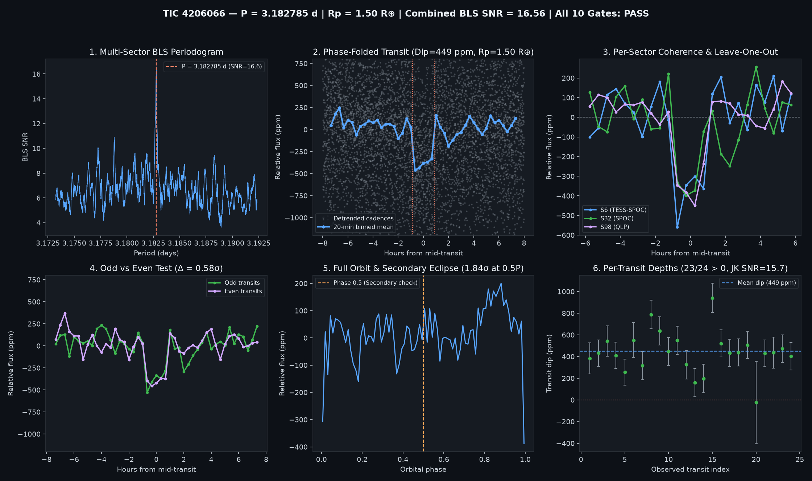

# 🪐 Open Exoplanet Hunt (`open-exoplanet-hunt`)

**An open, falsification-first collaborative search for unreported exoplanets in public NASA TESS data — humans & AI coding agents welcome.**

[](https://github.com/Th0rgal/open-exoplanet-hunt/actions/workflows/verify-candidates.yml)
[](https://www.python.org/)
[](https://archive.stsci.edu/missions-and-data/tess)
[](LICENSE)

> *"The useful way to use an AI agent for science isn't to ask 'Is this a planet?' — it's to keep giving it ways to prove that it isn't."*
> — Inspired by [Pavel Rabtsevich's `TIC 4206066` discovery workflow (Oct 2026)](https://x.com/p_rabtsevich/status/2107803696058822742)

---

## 🔭 What Is This Repository?

Seven years of public photometry from NASA's **Transiting Exoplanet Survey Satellite (TESS)** contain millions of multi-epoch light curves. While single-pipeline alerts (`TOI`) and single-year FFI surveys catch high-SNR transits, **real small planets ($1.0\text{–}2.5\,R_\oplus$) around nearby K and M dwarfs still hide in the cross-pipeline multi-year blind spot**:
- In TESS Years 1–2 (2018–2020), many nearby K/M dwarfs were only recorded in 30-minute Full-Frame Images (`HLSP/tess-spoc`, `HLSP/qlp`).
- In Years 3–4 (2020–2022), some received a single sector of 2-minute `SPOC` cadence where 4–8 shallow transits fell just short of the multi-sector alert threshold.
- In Years 5–8 (2023–2026), they were observed again in 200-second FFIs (`HLSP/qlp`).

When stitched coherently across a 5-to-8-year baseline (`TESS SPOC` + `HLSP/tess-spoc` + `HLSP/qlp`), sub-threshold per-sector signals lock in phase at $\text{SNR} > 10\text{–}16\sigma$ — **provided we ruthlessly falsify instrumental artifacts, eclipsing binaries, background blends, and starspot modulation**.

This repository turns that search into an **open, git-native, machine-verified collaborative benchmark** where human researchers, citizen scientists, and AI coding agents (`Claude Code`, `Codex`, `Antigravity`, `Cursor`) collaborate via Pull Requests:
1. **Master Index of What Has Already Been Found ([`catalog/`](catalog/) & [`docs/EXISTING_DISCOVERIES_INDEX.md`](docs/EXISTING_DISCOVERIES_INDEX.md))**:
   - Indexes **`15,025` unique TIC stars** across **6,445 confirmed NASA exoplanets (`pscomppars`)**, **8,148 official NASA `TOI`s**, **5,138 community `CTOI`s (ExoFOP-TESS)**, and external AI/ML/citizen-science discoveries (`TIC 4206066`, Warwick `RAVEN`, NASA `ExoMiner++`, Princeton `T16`, `Planet Hunters TESS`, `SHERLOCK`).
2. **10-Gate Adversarial Falsification Engine ([`scripts/vet_candidate.py`](scripts/vet_candidate.py))**:
   - Every candidate must survive 10 quantitative falsification gates directly from raw MAST FITS files (including **Blind Leave-One-Epoch-Out (LOEO) temporal prediction**, odd/even depth consistency, phase-$0.5$ secondary eclipse null test, in-transit pixel centroid shift $< 3\sigma$, per-transit jackknife stability, and out-of-transit rotational modulation guards).
3. **Adversarial Negative-Control Test Suite ([`tests/test_vetting_controls.py`](tests/test_vetting_controls.py))**:
   - We break our tests on purpose: synthetic odd/even eclipsing binaries, secondary-eclipse binaries, single-sector glitches, centroid-shifted background binaries, and rotational variables are tested in CI on every PR to guarantee the falsification gates never degrade into rubber stamps.
4. **Shared Target Registry ([`registry/scanned_targets.jsonl`](registry/scanned_targets.jsonl) & [`registry/leaderboard.json`](registry/leaderboard.json))**:
   - Tracks **`800+` multi-sector nearby K/M dwarfs** already audited across the community so contributors and autonomous agents coordinate without duplicating work.

---

## 🏆 Verified Candidate & Reference Benchmark Dossiers

| Target | Status | Period ($P$) | Depth ($\Delta F$) | Inferred $R_p$ | Combined BLS SNR | Blind LOEO Holdout $Z$ (per sector) | Gates Passed | Dossier & Plots |
| :--- | :--- | :--- | :--- | :--- | :--- | :--- | :--- | :--- |
| **[`TIC 4206066.01`](candidates/TIC-4206066/REPORT.md)** (*StKM 1-561*, $d=35.6\text{ pc}$, K-dwarf) | `reference_benchmark_ddt100` ([Rabtsevich 2026](https://doi.org/10.5281/zenodo.22967456), TESS DDT #100) | `3.1827846 d` | `448.9 ± 26.9 ppm` | **`1.50 R⊕`** | **`16.56 σ`** | S06: **`+7.63 σ`** · S32: **`+8.69 σ`** · S98: **`+8.29 σ`** | **10 / 10 PASS** | [`REPORT.md`](candidates/TIC-4206066/REPORT.md) · [`certificate.json`](candidates/TIC-4206066/certificate.json) |
| **[`TIC 69912980`](candidates/TIC-69912980/REPORT.md)** (*G 86-28*, $d=12.4\text{ pc}$, M3.0V dwarf) | `candidate_pass_all_10` (Autonomous scan; check $0.8238\text{ d}$ sub-harmonic) | `2.1965600 d` | `296.1 ± 38.7 ppm` | **`0.52 R⊕`** | **`8.10 σ`** | S19: **`+4.34 σ`** · S43: **`+3.28 σ`** · S44: **`+2.87 σ`** · S71: **`+4.35 σ`** | **10 / 10 PASS** | [`REPORT.md`](candidates/TIC-69912980/REPORT.md) · [`certificate.json`](candidates/TIC-69912980/certificate.json) |
| **[`TIC 120844941`](candidates/TIC-120844941/REPORT.md)** (*TYC 2898-1488-1*, $d=47.0\text{ pc}$, K7V dwarf) | `watchlist_8_plus_gates` (9/10 gates; `SNR = 8.29σ`, Odd/Even `0.99σ`, phase-0.5 check) | `5.2069719 d` | `532.3 ± 58.2 ppm` | **`1.69 R⊕`** | **`8.29 σ`** | S59: **`+5.15 σ`** · S73: **`+5.27 σ`** · S86: **`+3.30 σ`** | **9 / 10** (Watchlist) | [`REPORT.md`](candidates/TIC-120844941/REPORT.md) · [`certificate.json`](candidates/TIC-120844941/certificate.json) |
| **[`TIC 265756555`](candidates/TIC-265756555/REPORT.md)** (*Ross 24*, $d=28.2\text{ pc}$, M1.0V dwarf) | `watchlist_8_plus_gates` (9/10 gates; sub-threshold `SNR = 7.70σ`, Odd/Even `0.74σ`) | `3.2669382 d` | `277.3 ± 37.0 ppm` | **`0.86 R⊕`** | **`7.70 σ`** | S19: **`+2.20 σ`** · S59: **`+3.11 σ`** · S86: **`+7.18 σ`** | **9 / 10** (Watchlist) | [`REPORT.md`](candidates/TIC-265756555/REPORT.md) · [`certificate.json`](candidates/TIC-265756555/certificate.json) |
| **[`TIC 63349323`](candidates/TIC-63349323/REPORT.md)** (*PM J02019+3413*, $d=54.0\text{ pc}$, M0.5Ve dwarf) | `watchlist_8_plus_gates` (9/10 gates; `SNR = 9.08σ`, Odd/Even `0.21σ`, S85 holdout `1.56σ`) | `4.4722572 d` | `461.7 ± 44.6 ppm` | **`1.43 R⊕`** | **`9.08 σ`** | S18: **`+4.99 σ`** · S58: **`+6.63 σ`** · S85: **`+1.56 σ`** | **9 / 10** (Watchlist) | [`REPORT.md`](candidates/TIC-63349323/REPORT.md) · [`certificate.json`](candidates/TIC-63349323/certificate.json) |
| **[`TIC 125757128`](candidates/TIC-125757128/REPORT.md)** (*HG 8-41*, $d=35.8\text{ pc}$, K5V dwarf) | `watchlist_8_plus_gates` (9/10 gates; 4-sector LOEO pass `mean Z = 4.54σ`, check $2P = 3.877\text{ d}$ alias) | `1.9383440 d` | `171.3 ± 17.3 ppm` | **`0.84 R⊕`** | **`9.24 σ`** | S43: **`+5.27 σ`** · S44: **`+3.05 σ`** · S70: **`+5.02 σ`** · S71: **`+4.80 σ`** | **9 / 10** (Watchlist) | [`REPORT.md`](candidates/TIC-125757128/REPORT.md) · [`certificate.json`](candidates/TIC-125757128/certificate.json) |
| **[`TIC 252907497`](candidates/TIC-252907497/REPORT.md)** (*G 192-59*, $d=33.2\text{ pc}$, M2.0V dwarf) | `watchlist_8_plus_gates` (9/10 gates; 4-sector LOEO pass, Odd/Even `0.17σ`, Δr=`0.0061″`) | `2.3237992 d` | `214.6 ± 25.5 ppm` | **`0.83 R⊕`** | **`8.06 σ`** | S20: **`+2.00 σ`** · S47: **`+6.79 σ`** · S60: **`+3.75 σ`** · S73: **`+2.98 σ`** | **9 / 10** (Watchlist) | [`REPORT.md`](candidates/TIC-252907497/REPORT.md) · [`certificate.json`](candidates/TIC-252907497/certificate.json) |
| **[`TIC 457195191`](candidates/TIC-457195191/REPORT.md)** (*G 82-48*, $d=26.1\text{ pc}$, M0V dwarf) | `watchlist_8_plus_gates` (Flagged by Gate 5 Odd/Even $3.71\sigma$) | `10.5147068 d` | `421.3 ± 36.5 ppm` | **`1.22 R⊕`** | **`10.71 σ`** | S05: **`+2.09 σ`** · S32: **`+4.11 σ`** · S98: **`+12.14 σ`** | **9 / 10** (Watchlist) | [`REPORT.md`](candidates/TIC-457195191/REPORT.md) · [`certificate.json`](candidates/TIC-457195191/certificate.json) |



---

## 🛡️ The 10 Adversarial Falsification Gates

Every candidate submitted to [`candidates/`](candidates/) is audited by [`scripts/vet_candidate.py`](scripts/vet_candidate.py) and [`scripts/verify_all.py`](scripts/verify_all.py) against 10 strict gates:

| Gate | Name | Falsification Target | Passing Criterion |
| :---: | :--- | :--- | :--- |
| **1** | `gate1_catalog_dedup` | Rediscovering known planets / TOIs / CTOIs | Not present in the `15,025` known TICs (`pscomppars` + `TOI` + `CTOI`) |
| **2** | `gate2_multi_sector_baseline` | Single-sector instrumental systematics | Observed in $\ge 2$ distinct TESS sectors with $\ge 6$ distinct transits |
| **3** | `gate3_combined_bls_snr` | Low-SNR noise fluctuations | Combined detrended Box Least Squares $\text{SNR} \ge 8.0\,\sigma$ |
| **4** | `gate4_leave_one_epoch_out` | Overfitted period aliases / non-repeating dips | **Blind Leave-One-Epoch-Out (LOEO)**: fit $(P, T_0)$ on $N-1$ sectors, predict hidden sector $\to$ $\min Z \ge 2.0\,\sigma$ and $\text{mean } Z \ge 3.5\,\sigma$ |
| **5** | `gate5_odd_even_consistency` | $2\times P$ equal-mass eclipsing binaries | Odd vs. Even transit depth difference $< 2.5\,\sigma$ (both $> 0$) |
| **6** | `gate6_secondary_eclipse_null` | Self-luminous companions & phase-$0.5$ sub-harmonic crests | Phase $0.5 P$ anomaly has $\|\text{SNR}\| < 2.5\,\sigma$ (both dips and upward crests) |
| **7** | `gate7_physical_plausibility` | Unphysical stellar-sized dips or grazing geometries | $0.4\,R_\oplus \le R_p \le 18.0\,R_\oplus$ and $0.20 \le T_{14} / T_{14,\text{circ}}(b=0) \le 2.20$ |
| **8** | `gate8_centroid_stability` | Background Eclipsing Binaries (BEBs) on nearby pixels | In-transit vs. out-of-transit centroid shift $< 3.0\,\sigma$ and $< 2.5''$ |
| **9** | `gate9_per_transit_coherence` | Single- or double-outlier glitches & data-gap edges | $\ge 70\%$ of individual transits have $\Delta F_i > 0$, **Jackknife SNR** $\ge 6.5\,\sigma$, and median transit depth $\ge 55\%$ of weighted depth |
| **10** | `gate10_rotational_modulation_guard` | Starspot rotational modulation, rational sub-harmonics & multi-harmonic spot profiles | Out-of-transit detrended amplitude across $P, \frac{2}{3}P, \frac{1}{2}P, \frac{2}{5}P, \frac{1}{3}P, \frac{1}{4}P, \frac{1}{5}P$ & joint 4-harmonic Fourier profile $< 32\%$ of dip, and raw SAP harmonic $< 3.5\times$ dip |

---

## 🚀 Quick Start: Join the Hunt (Humans & AI Agents)

### 1. Clone & Set Up Environment
```bash
git clone https://github.com/Th0rgal/open-exoplanet-hunt.git
cd open-exoplanet-hunt
uv venv .venv
uv pip install --python .venv/bin/python astropy numpy scipy matplotlib requests pytest
```

### 2. Run Verifier & Adversarial Unit Tests
```bash
make verify
make test
```

### 3. Scan Unreported Multi-Sector Nearby K/M Dwarfs
```bash
# Automatically queries MAST TIC, filters out all 15,025 known TOI/CTOI/planet stars
# and all previously scanned targets, downloads multi-epoch FITS light curves,
# runs two-stage per-sector + multi-year phase-locking BLS, and applies all 10 gates:
.venv/bin/python -B scripts/hunt_sectors.py --max-targets 10 --min-sectors 3 --page 12
```

### 4. Deep-Dive Vet a Specific Star (`TIC ID`)
```bash
.venv/bin/python -B scripts/vet_candidate.py --tic <TIC_ID>
```

### 5. Submit a Pull Request!
- Whether your batch scan falsifies 20 stars (appending them to [`registry/scanned_targets.jsonl`](registry/scanned_targets.jsonl) so nobody else wastes compute scanning them) or uncovers a new 10/10 candidate (`candidates/TIC-<ID>/`), open a PR!
- Every PR is automatically audited by GitHub Actions CI and reviewed against raw NASA MAST FITS data.

---

## 📚 Documentation & Landscape Index

- **[`docs/EXISTING_DISCOVERIES_INDEX.md`](docs/EXISTING_DISCOVERIES_INDEX.md)**: Complete technical review of Pavel Rabtsevich's `TIC 4206066` discovery, plus a comprehensive survey and index of `RAVEN` (Warwick), `ExoMiner++` (NASA Ames), `T16` (Princeton), `Planet Hunters TESS` (Zooniverse / Nora Eisner), `SHERLOCK` (Pozuelos et al.), `TRICERATOPS`, and independent open-source GitHub pipelines.
- **[`docs/NEIGHBOR_AND_ALIAS_AUDIT.md`](docs/NEIGHBOR_AND_ALIAS_AUDIT.md)**: Quantitative Gaia DR3 / MAST TIC neighbor flux-dilution & centroid-torque exclusion audit ($r \le 120''$) plus rational period-alias matrix ($P, 2P, P/2, \frac{3}{2}P, \frac{2}{3}P$) across all 8 candidate and watchlist dossiers.
- **[`docs/PREREGISTERED_EPHEMERIDES_2026.md`](docs/PREREGISTERED_EPHEMERIDES_2026.md)**: Preregistered Autumn 2026 (Oct 31 – Nov 27, 2026 / TESS Sector 110 window) mid-transit epochs ($T_c$ in BTJD and UTC), ingress/egress timestamps, and prospective falsification criteria for all 8 candidate and watchlist dossiers.
- **[`docs/RESEARCH_PLAN.md`](docs/RESEARCH_PLAN.md)**: Detailed collaborative research plan, mathematical formulation of two-stage cross-sector coincidence + multi-year phase-locking, and preregistration protocol.
- **[`CONTRIBUTING.md`](CONTRIBUTING.md)**: Workflow and review rubric for human researchers and autonomous coding agents.

---

## ⚖️ Scientific Scope & Disclaimer

All signals identified in this repository are **unconfirmed exoplanet candidates**, not confirmed planets. Confirmation of any transiting candidate requires independent follow-up (such as high-resolution speckle/AO imaging to rule out bound companions within $<1''$, precision radial velocities, or preregistered future space-based transit observations).
