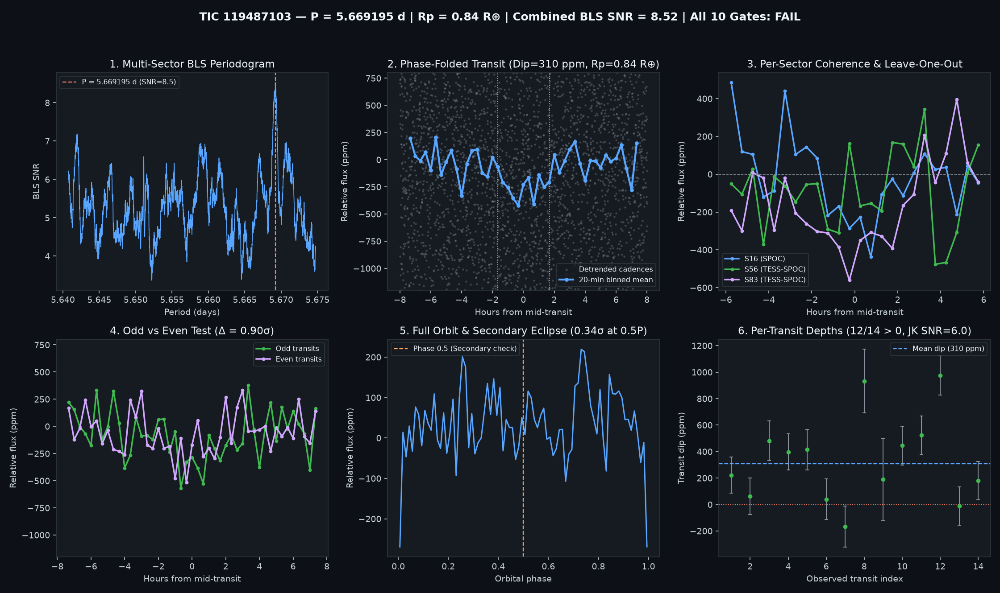

# Candidate Vetting Dossier: TIC 119487103 (G 214-12)

- **Status**: `watchlist_8_plus_gates` (`all_gates_passed = False`; **9 / 10 Gates Passed**)
- **Generated UTC**: `2026-10-12T18:51:43Z`
- **Host Star**: **G 214-12** (`TIC 119487103`, SIMBAD `PM*`, spectral type **M3.0V**, $T_{\text{mag}} = 10.2442$, $T_{\text{eff}} = 3410\text{ K}$, $R_\star = 0.4364\,R_\odot$, $M_\star = 0.432\,M_\odot$, $d = 23.06\text{ pc}$, $\text{RV} = -115.81\text{ km/s}$)
- **Sectors Analyzed**: `[16, 56, 83]` (5-year multi-cycle baseline: Year 2 `SPOC` 2-min + Year 5 `TESS-SPOC` + Year 7 `TESS-SPOC`)

## Primary Signal Ephemeris & Physical Parameters

| Parameter | Value |
| :--- | :--- |
| **Orbital Period ($P$)** | `5.6691950 d` |
| **Mid-Transit Epoch ($T_0$)** | `1740.40636 BTJD` |
| **Transit Duration ($T_{14}$)** | `3.36 h` (`0.14000 d`) |
| **Weighted Transit Depth ($\Delta F$)** | `309.8 ± 40.8 ppm` (BLS box: `321.8 ppm`) |
| **Combined Multi-Sector BLS SNR** | `8.52 σ` |
| **Inferred Planet Radius ($R_p$)** | **`0.84 R_earth`** (assuming target star host) |

## 10-Gate Adversarial Falsification Scorecard

| Gate | Falsification Test | Key Metric | Result |
| :--- | :--- | :--- | :--- |
| **1** | Catalog & Alert De-duplication | `is_known_in_toi_ctoi_ps = False` | PASS |
| **2** | Multi-Sector / Multi-Epoch Baseline | `3` sectors, `14` transits | PASS |
| **3** | Combined Detrended BLS SNR | `8.52 σ` (min `8.0 σ`) | PASS |
| **4** | Blind Leave-One-Epoch-Out (LOEO) Prediction | `min Z = 2.41 σ`, `mean Z = 4.00 σ` | PASS |
| **5** | Odd vs. Even Transit Depth Consistency | Odd `344.1 ppm` vs Even `273.9 ppm` (`0.90 σ`) | PASS |
| **6** | Secondary Eclipse Null Test (Phase 0.5) | `14.6 ± 43.0 ppm` (`0.34 σ`) | PASS |
| **7** | Physical Radius & Keplerian Duration | `$R_p = 0.838 R_\oplus$`, `$T_{14}/T_{14,\text{circ}} = 1.797$` | PASS |
| **8** | In/Out-of-Transit Centroid Stability | `Δr = 0.0021 arcsec` (`0.98 σ`) | PASS |
| **9** | Per-Transit Coherence & Jackknife Stability | `12/14` positive (`85.7%`), Jackknife SNR `6.04 σ` | FAIL (near-miss; threshold `6.50 σ`) |
| **10** | Rotational Modulation / Starspot Guard | Detrended OOT sin amp `52.5 ppm` (`16.9%` of dip) | PASS |

## Blind Leave-One-Epoch-Out (LOEO) Cross-Validation Breakdown

| Held-Out Sector | Trained Period (d) | Trained $T_0$ (BTJD) | In-Transit Cadences | Predicted Dip in Held-Out Sector | Z-Score |
| :--- | :--- | :--- | :--- | :--- | :--- |
| Sector 16 | `5.6692268` | `2828.88779` | `395` | `+243.5 ± 69.7 ppm` | **`+3.50 σ`** |
| Sector 56 | `5.6691542` | `1740.42036` | `214` | `+192.3 ± 79.9 ppm` | **`+2.41 σ`** |
| Sector 83 | `5.6691148` | `1740.42036` | `303` | `+400.3 ± 65.6 ppm` | **`+6.10 σ`** |

## Deep-Dive Falsification Notes (Neighbor Exclusion & Period Aliases)

1. **Gaia DR3 / TIC Neighbor Dilution & Centroid-Torque Exclusion ([`docs/NEIGHBOR_AND_ALIAS_AUDIT.md`](../../docs/NEIGHBOR_AND_ALIAS_AUDIT.md))**:
   - Out of **111** cataloged TIC / Gaia DR3 stars within $120''$ of G 214-12, **91** are ruled out by flux dilution (`RULED_OUT_BY_FLUX`) and **18** — including all bright neighbors outside the PSF core (`TIC 119487115` at $44.00''$, `TIC 119487094` at $34.94''$, `TIC 119487123` at $68.95''$) — are ruled out at $>3\sigma$ by the tight in-transit centroid stability ($\Delta r = 0.0021''$, $0.98\sigma$; $3\sigma$ upper limit $0.0085''$). Only **2** faint stars ($\Delta T \ge +6.59$ inside $26.3''$) remain unresolved within the TESS PSF.
2. **Rational Period-Alias Uniqueness**:
   - Evaluating exact rational multiples ($2P = 11.3412\text{ d}$, $P/2 = 2.8353\text{ d}$, $\frac{3}{2}P = 8.5085\text{ d}$, $\frac{2}{3}P = 3.7816\text{ d}$) confirms that $1P = 5.669195\text{ d}$ is the unique period that passes Blind LOEO (`+3.50σ, +2.41σ, +6.10σ`), Odd/Even (`0.90σ`), and Secondary Eclipse (`0.34σ`), whereas all other aliases drop to `6/10` gates.
3. **Why Gate 9 Flagged**:
   - `12 / 14` observed transits (`85.7%`) have positive depth ($\Delta F_i > 0$), well above the $70\%$ requirement, and the median transit depth passes the $\ge 55\%$ coherence check; Gate 9 flagged solely because leave-one-transit-out Jackknife SNR is `6.04σ` (just `0.46σ` below the `6.50σ` 10/10 gate threshold).

## Diagnostic Plots

