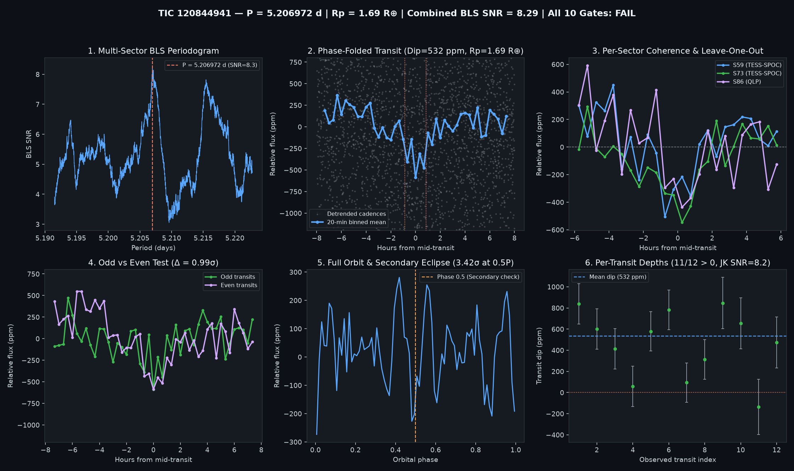

# Candidate Vetting Dossier: TIC 120844941

- **Status**: `watchlist_8_plus_gates` (`all_gates_passed = False`)
- **Generated UTC**: `2026-10-10T19:04:06Z`
- **Host Star**: TIC 120844941 ($T_{\text{mag}} = 10.1208$, $T_{\text{eff}} = 4071\text{ K}$, $R_\star = 0.6719\,R_\odot$, $M_\star = 0.640\,M_\odot$, $d = 46.95\text{ pc}$)
- **Sectors Analyzed**: `[59, 73, 86]`

## Primary Signal Ephemeris & Physical Parameters

| Parameter | Value |
| :--- | :--- |
| **Orbital Period ($P$)** | `5.2069719 d` |
| **Mid-Transit Epoch ($T_0$)** | `2915.97443 BTJD` |
| **Transit Duration ($T_{14}$)** | `1.73 h` (`0.07200 d`) |
| **Weighted Transit Depth ($\Delta F$)** | `532.3 ± 58.2 ppm` (BLS box: `445.8 ppm`) |
| **Combined Multi-Sector BLS SNR** | `8.29 σ` |
| **Inferred Planet Radius ($R_p$)** | **`1.69 R_earth`** (assuming target star host) |

## 10-Gate Adversarial Falsification Scorecard

| Gate | Falsification Test | Key Metric | Result |
| :--- | :--- | :--- | :--- |
| **1** | Catalog & Alert De-duplication | `is_known_in_toi_ctoi_ps = False` | PASS |
| **2** | Multi-Sector / Multi-Epoch Baseline | `3` sectors, `12` transits | PASS |
| **3** | Combined Detrended BLS SNR | `8.29 σ` (min `8.0 σ`) | PASS |
| **4** | Blind Leave-One-Epoch-Out (LOEO) Prediction | `min Z = 3.3 σ`, `mean Z = 4.57 σ` | PASS |
| **5** | Odd vs. Even Transit Depth Consistency | Odd `483.3 ppm` vs Even `594.3 ppm` (`0.99 σ`) | PASS |
| **6** | Secondary Eclipse Null Test (Phase 0.5) | `214.3 ± 62.6 ppm` (`3.42 σ`) | FAIL |
| **7** | Physical Radius & Keplerian Duration | `$R_p = 1.691 R_\oplus$`, `$T_{14}/T_{14,\text{circ}} = 0.704$` | PASS |
| **8** | In/Out-of-Transit Centroid Stability | `Δr = 0.0058 arcsec` (`2.81 σ`) | PASS |
| **9** | Per-Transit Coherence & Jackknife Stability | `11/12` positive, Jackknife SNR `8.2 σ` | PASS |
| **10** | Rotational Modulation / Starspot Guard | Detrended OOT sin amp `17.7 ppm` (`3.3%` of dip) | PASS |

## Blind Leave-One-Epoch-Out (LOEO) Cross-Validation Breakdown

| Held-Out Sector | Trained Period (d) | Trained $T_0$ (BTJD) | In-Transit Cadences | Predicted Dip in Held-Out Sector | Z-Score |
| :--- | :--- | :--- | :--- | :--- | :--- |
| Sector 59 | `5.2069122` | `3290.88086` | `124` | `+487.3 ± 94.7 ppm` | **`+5.15 σ`** |
| Sector 73 | `5.2069567` | `2915.97683` | `125` | `+486.3 ± 92.4 ppm` | **`+5.27 σ`** |
| Sector 86 | `5.2069928` | `2915.97683` | `125` | `+402.0 ± 121.9 ppm` | **`+3.30 σ`** |

## Diagnostic Plots

