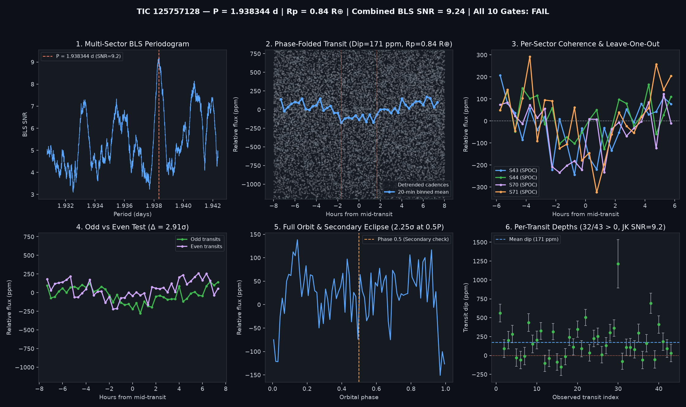

# Candidate Vetting Dossier: TIC 125757128

- **Status**: `watchlist_8_plus_gates` (`all_gates_passed = False`)
- **Generated UTC**: `2026-10-10T20:09:11Z`
- **Host Star**: TIC 125757128 ($T_{\text{mag}} = 9.90291$, $T_{\text{eff}} = 3868\text{ K}$, $R_\star = 0.5907\,R_\odot$, $M_\star = 0.580\,M_\odot$, $d = 35.82\text{ pc}$)
- **Sectors Analyzed**: `[43, 44, 70, 71]`

## Primary Signal Ephemeris & Physical Parameters

| Parameter | Value |
| :--- | :--- |
| **Orbital Period ($P$)** | `1.9383440 d` |
| **Mid-Transit Epoch ($T_0$)** | `2475.42348 BTJD` |
| **Transit Duration ($T_{14}$)** | `3.36 h` (`0.14000 d`) |
| **Weighted Transit Depth ($\Delta F$)** | `171.3 ± 17.3 ppm` (BLS box: `151.7 ppm`) |
| **Combined Multi-Sector BLS SNR** | `9.24 σ` |
| **Inferred Planet Radius ($R_p$)** | **`0.84 R_earth`** (assuming target star host) |

## 10-Gate Adversarial Falsification Scorecard

| Gate | Falsification Test | Key Metric | Result |
| :--- | :--- | :--- | :--- |
| **1** | Catalog & Alert De-duplication | `is_known_in_toi_ctoi_ps = False` | PASS |
| **2** | Multi-Sector / Multi-Epoch Baseline | `4` sectors, `43` transits | PASS |
| **3** | Combined Detrended BLS SNR | `9.24 σ` (min `8.0 σ`) | PASS |
| **4** | Blind Leave-One-Epoch-Out (LOEO) Prediction | `min Z = 3.05 σ`, `mean Z = 4.54 σ` | PASS |
| **5** | Odd vs. Even Transit Depth Consistency | Odd `217.5 ppm` vs Even `121.2 ppm` (`2.91 σ`) | FAIL |
| **6** | Secondary Eclipse Null Test (Phase 0.5) | `37.6 ± 16.7 ppm` (`2.25 σ`) | PASS |
| **7** | Physical Radius & Keplerian Duration | `$R_p = 0.843 R_\oplus$`, `$T_{14}/T_{14,\text{circ}} = 2.092$` | PASS |
| **8** | In/Out-of-Transit Centroid Stability | `Δr = 0.0019 arcsec` (`1.93 σ`) | PASS |
| **9** | Per-Transit Coherence & Jackknife Stability | `32/43` positive, Jackknife SNR `9.16 σ` | PASS |
| **10** | Rotational Modulation / Starspot Guard | Detrended OOT sin amp `29.1 ppm` (`17.0%` of dip) | PASS |

## Blind Leave-One-Epoch-Out (LOEO) Cross-Validation Breakdown

| Held-Out Sector | Trained Period (d) | Trained $T_0$ (BTJD) | In-Transit Cadences | Predicted Dip in Held-Out Sector | Z-Score |
| :--- | :--- | :--- | :--- | :--- | :--- |
| Sector 43 | `1.9383487` | `2500.61240` | `1009` | `+193.3 ± 36.7 ppm` | **`+5.27 σ`** |
| Sector 44 | `1.9382908` | `2475.44348` | `1208` | `+95.8 ± 31.4 ppm` | **`+3.05 σ`** |
| Sector 70 | `1.9383528` | `2475.41548` | `922` | `+178.3 ± 35.6 ppm` | **`+5.02 σ`** |
| Sector 71 | `1.9382298` | `2475.44348` | `1072` | `+170.5 ± 35.5 ppm` | **`+4.80 σ`** |

## Diagnostic Plots

