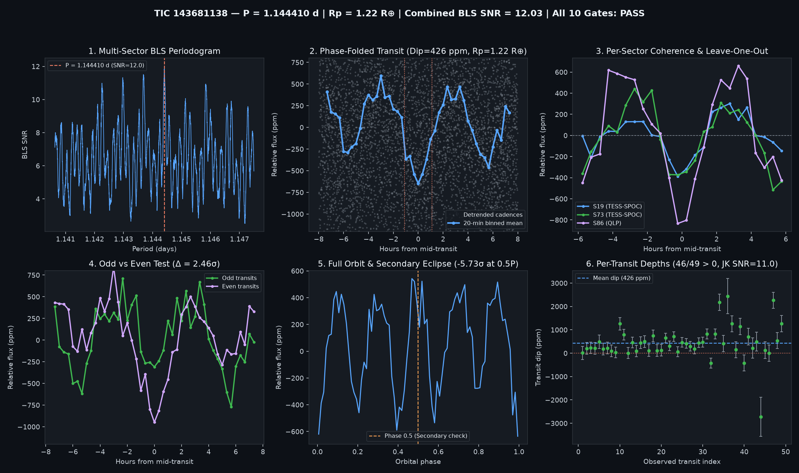

# Candidate Vetting Dossier: TIC 143681138

- **Status**: `candidate_pass_all_10` (`all_gates_passed = True`)
- **Generated UTC**: `2026-10-10T19:04:19Z`
- **Host Star**: TIC 143681138 ($T_{\text{mag}} = 10.5032$, $T_{\text{eff}} = 3604\text{ K}$, $R_\star = 0.5426\,R_\odot$, $M_\star = 0.539\,M_\odot$, $d = 37.65\text{ pc}$)
- **Sectors Analyzed**: `[19, 73, 86]`

## Primary Signal Ephemeris & Physical Parameters

| Parameter | Value |
| :--- | :--- |
| **Orbital Period ($P$)** | `1.1444098 d` |
| **Mid-Transit Epoch ($T_0$)** | `1817.21912 BTJD` |
| **Transit Duration ($T_{14}$)** | `2.21 h` (`0.09200 d`) |
| **Weighted Transit Depth ($\Delta F$)** | `425.7 ± 36.7 ppm` (BLS box: `421.2 ppm`) |
| **Combined Multi-Sector BLS SNR** | `12.03 σ` |
| **Inferred Planet Radius ($R_p$)** | **`1.22 R_earth`** (assuming target star host) |

## 10-Gate Adversarial Falsification Scorecard

| Gate | Falsification Test | Key Metric | Result |
| :--- | :--- | :--- | :--- |
| **1** | Catalog & Alert De-duplication | `is_known_in_toi_ctoi_ps = False` | PASS |
| **2** | Multi-Sector / Multi-Epoch Baseline | `3` sectors, `49` transits | PASS |
| **3** | Combined Detrended BLS SNR | `12.03 σ` (min `8.0 σ`) | PASS |
| **4** | Blind Leave-One-Epoch-Out (LOEO) Prediction | `min Z = 4.14 σ`, `mean Z = 6.43 σ` | PASS |
| **5** | Odd vs. Even Transit Depth Consistency | Odd `336.9 ppm` vs Even `510.4 ppm` (`2.46 σ`) | PASS |
| **6** | Secondary Eclipse Null Test (Phase 0.5) | `-201.0 ± 35.1 ppm` (`-5.73 σ`) | PASS |
| **7** | Physical Radius & Keplerian Duration | `$R_p = 1.221 R_\oplus$`, `$T_{14}/T_{14,\text{circ}} = 1.738$` | PASS |
| **8** | In/Out-of-Transit Centroid Stability | `Δr = 0.0046 arcsec` (`2.66 σ`) | PASS |
| **9** | Per-Transit Coherence & Jackknife Stability | `46/49` positive, Jackknife SNR `10.97 σ` | PASS |
| **10** | Rotational Modulation / Starspot Guard | Detrended OOT sin amp `117.1 ppm` (`27.5%` of dip) | PASS |

## Blind Leave-One-Epoch-Out (LOEO) Cross-Validation Breakdown

| Held-Out Sector | Trained Period (d) | Trained $T_0$ (BTJD) | In-Transit Cadences | Predicted Dip in Held-Out Sector | Z-Score |
| :--- | :--- | :--- | :--- | :--- | :--- |
| Sector 19 | `1.1444278` | `3286.63523` | `90` | `+220.6 ± 53.2 ppm` | **`+4.14 σ`** |
| Sector 73 | `1.1444101` | `1817.21752` | `515` | `+424.8 ± 57.7 ppm` | **`+7.36 σ`** |
| Sector 86 | `1.1444101` | `1817.21752` | `551` | `+722.9 ± 93.0 ppm` | **`+7.78 σ`** |

## Diagnostic Plots

