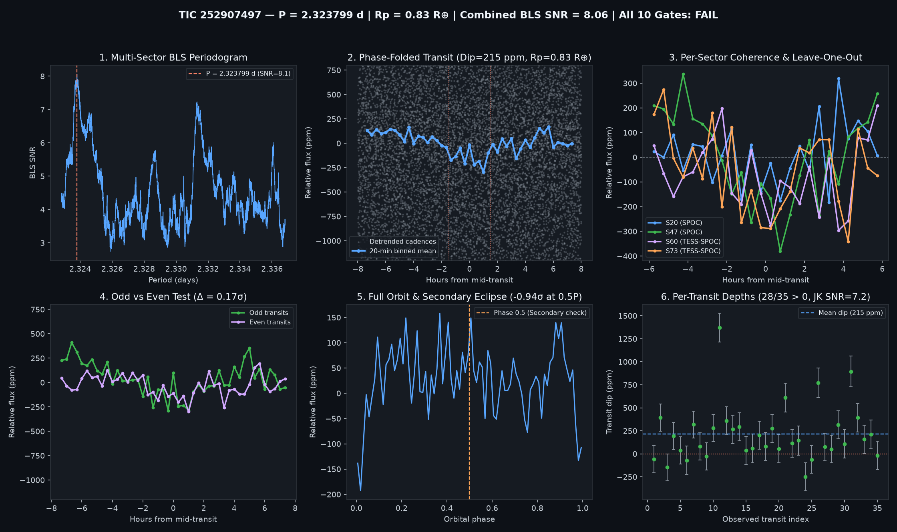

# Candidate Vetting Dossier: TIC 252907497

- **Status**: `watchlist_8_plus_gates` (`all_gates_passed = False`)
- **Generated UTC**: `2026-10-10T20:50:42Z`
- **Host Star**: TIC 252907497 ($T_{\text{mag}} = 10.3553$, $T_{\text{eff}} = 3605\text{ K}$, $R_\star = 0.5217\,R_\odot$, $M_\star = 0.519\,M_\odot$, $d = 33.23\text{ pc}$)
- **Sectors Analyzed**: `[20, 47, 60, 73]`

## Primary Signal Ephemeris & Physical Parameters

| Parameter | Value |
| :--- | :--- |
| **Orbital Period ($P$)** | `2.3237992 d` |
| **Mid-Transit Epoch ($T_0$)** | `1844.33500 BTJD` |
| **Transit Duration ($T_{14}$)** | `2.98 h` (`0.12400 d`) |
| **Weighted Transit Depth ($\Delta F$)** | `214.6 ± 25.5 ppm` (BLS box: `193.0 ppm`) |
| **Combined Multi-Sector BLS SNR** | `8.06 σ` |
| **Inferred Planet Radius ($R_p$)** | **`0.83 R_earth`** (assuming target star host) |

## 10-Gate Adversarial Falsification Scorecard

| Gate | Falsification Test | Key Metric | Result |
| :--- | :--- | :--- | :--- |
| **1** | Catalog & Alert De-duplication | `is_known_in_toi_ctoi_ps = False` | PASS |
| **2** | Multi-Sector / Multi-Epoch Baseline | `4` sectors, `35` transits | PASS |
| **3** | Combined Detrended BLS SNR | `8.06 σ` (min `8.0 σ`) | PASS |
| **4** | Blind Leave-One-Epoch-Out (LOEO) Prediction | `min Z = 2.0 σ`, `mean Z = 3.88 σ` | PASS |
| **5** | Odd vs. Even Transit Depth Consistency | Odd `210.0 ppm` vs Even `218.4 ppm` (`0.17 σ`) | PASS |
| **6** | Secondary Eclipse Null Test (Phase 0.5) | `-24.2 ± 25.7 ppm` (`-0.94 σ`) | PASS |
| **7** | Physical Radius & Keplerian Duration | `$R_p = 0.833 R_\oplus$`, `$T_{14}/T_{14,\text{circ}} = 1.904$` | PASS |
| **8** | In/Out-of-Transit Centroid Stability | `Δr = 0.0061 arcsec` (`3.96 σ`) | FAIL |
| **9** | Per-Transit Coherence & Jackknife Stability | `28/35` positive, Jackknife SNR `7.18 σ` | PASS |
| **10** | Rotational Modulation / Starspot Guard | Detrended OOT sin amp `20.1 ppm` (`9.3%` of dip) | PASS |

## Blind Leave-One-Epoch-Out (LOEO) Cross-Validation Breakdown

| Held-Out Sector | Trained Period (d) | Trained $T_0$ (BTJD) | In-Transit Cadences | Predicted Dip in Held-Out Sector | Z-Score |
| :--- | :--- | :--- | :--- | :--- | :--- |
| Sector 20 | `2.3238258` | `2580.97091` | `891` | `+93.3 ± 46.6 ppm` | **`+2.00 σ`** |
| Sector 47 | `2.3237973` | `1844.33580` | `983` | `+313.1 ± 46.1 ppm` | **`+6.79 σ`** |
| Sector 60 | `2.3237973` | `1844.33580` | `427` | `+199.6 ± 53.3 ppm` | **`+3.75 σ`** |
| Sector 73 | `2.3238717` | `1844.33580` | `320` | `+186.6 ± 62.5 ppm` | **`+2.98 σ`** |

## Diagnostic Plots

