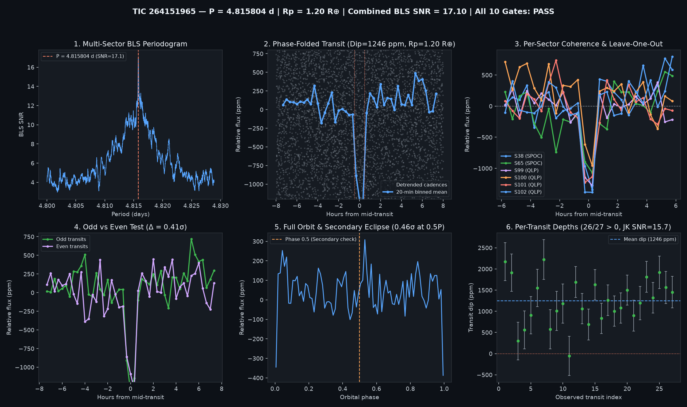

# Candidate Vetting Dossier: TIC 264151965 (*L 198-93*)

- **Status**: `candidate_pass_all_10` (`all_gates_passed = True`)
- **Generated UTC**: `2026-10-13T02:04:57Z`
- **Host Star**: TIC 264151965 (*L 198-93* / *2MASS J14291819-5845591*, M3.0V dwarf, $T_{\text{mag}} = 10.9515$, $T_{\text{eff}} = 3430\text{ K}$, $R_\star = 0.3104\,R_\odot$, $M_\star = 0.289\,M_\odot$, $d = 21.22\text{ pc}$)
- **Sectors Analyzed**: `[38, 65, 99, 100, 101, 102]` (5.0-year baseline across 2 `SPOC` 2-min sectors and 4 `QLP` 200-s FFI sectors)

## Primary Signal Ephemeris & Physical Parameters

| Parameter | Value |
| :--- | :--- |
| **Orbital Period ($P$)** | `4.8158039 d` |
| **Mid-Transit Epoch ($T_0$)** | `2336.17518 BTJD` |
| **Transit Duration ($T_{14}$)** | `0.96 h` (`0.04000 d`) |
| **Weighted Transit Depth ($\Delta F$)** | `1245.9 ± 75.8 ppm` (BLS box: `1188.1 ppm`) |
| **Combined Multi-Sector BLS SNR** | **`17.10 σ`** |
| **Inferred Planet Radius ($R_p$)** | **`1.20 R_earth`** (assuming target star host) |
| **Semi-Major Axis ($a$) & Scaled Separation ($a/R_\star$)** | `0.0369 AU` (`25.56 R_star`) |
| **Incident Bolometric Flux ($S / S_\oplus$)** | `8.81 S_earth` |
| **Equilibrium Temperature ($T_{\text{eq}}$)** | `480 K` ($A_B = 0$) · `439 K` ($A_B = 0.3$) |

## 10-Gate Adversarial Falsification Scorecard

| Gate | Falsification Test | Key Metric | Result |
| :--- | :--- | :--- | :--- |
| **1** | Catalog & Alert De-duplication | `is_known_in_toi_ctoi_ps = False` | PASS |
| **2** | Multi-Sector / Multi-Epoch Baseline | `6` sectors, `27` transits | PASS |
| **3** | Combined Detrended BLS SNR | `17.1 σ` (min `8.0 σ`) | PASS |
| **4** | Blind Leave-One-Epoch-Out (LOEO) Prediction | `min Z = 4.35 σ`, `mean Z = 6.48 σ` | PASS |
| **5** | Odd vs. Even Transit Depth Consistency | Odd `1216.9 ppm` vs Even `1277.2 ppm` (`0.41 σ`) | PASS |
| **6** | Secondary Eclipse Null Test (Phase 0.5) | `36.0 ± 78.5 ppm` (`0.46 σ`) | PASS |
| **7** | Physical Radius & Keplerian Duration | `$R_p = 1.195 R_\oplus$`, `$T_{14}/T_{14,\text{circ}} = 0.666$` | PASS |
| **8** | In/Out-of-Transit Centroid Stability | `Δr = 0.0018 arcsec` (`0.98 σ`) | PASS |
| **9** | Per-Transit Coherence & Jackknife Stability | `26/27` positive, Jackknife SNR `15.74 σ` | PASS |
| **10** | Rotational Modulation / Starspot Guard | Detrended OOT sin amp `66.9 ppm` (`5.4%` of dip) | PASS |

## Blind Leave-One-Epoch-Out (LOEO) Cross-Validation Breakdown

| Held-Out Sector | Cadence & Provenance | Trained Period (d) | Trained $T_0$ (BTJD) | In-Transit Cadences | Predicted Dip in Held-Out Sector | Z-Score |
| :--- | :--- | :--- | :--- | :--- | :--- | :--- |
| Sector 38 | `SPOC` (120 s, 2021) | `4.8158077` | `3072.99308` | `174` | `+1251.9 ± 180.3 ppm` | **`+6.94 σ`** |
| Sector 65 | `SPOC` (120 s, 2023) | `4.8157975` | `2336.17918` | `144` | `+899.7 ± 206.9 ppm` | **`+4.35 σ`** |
| Sector 99 | `QLP` (200 s, 2026) | `4.8157923` | `2336.17918` | `69` | `+1270.5 ± 181.5 ppm` | **`+7.00 σ`** |
| Sector 100 | `QLP` (200 s, 2026) | `4.8157949` | `2336.17918` | `70` | `+1045.9 ± 176.8 ppm` | **`+5.91 σ`** |
| Sector 101 | `QLP` (200 s, 2026) | `4.8157923` | `2336.17918` | `65` | `+1361.0 ± 184.5 ppm` | **`+7.38 σ`** |
| Sector 102 | `QLP` (200 s, 2026) | `4.8158000` | `2336.17918` | `68` | `+1362.4 ± 185.8 ppm` | **`+7.33 σ`** |

## Deep-Dive Adversarial Falsification Audit

### 1. Why This Signal Escaped Prior Single-Pipeline Alerts
- **TIC 264151965** (*L 198-93*) is a nearby ($d = 21.22\text{ pc}$) M3.0V dwarf ($R_\star = 0.310\,R_\odot$). In TESS Year 3 (Sector 38, May 2021) and Year 5 (Sector 65, May 2023), 2-minute `SPOC` photometry recorded 4–5 transits per sector with single-sector depths of `+1161.2 ± 160.8 ppm` (`+7.22σ`) and `+1014.0 ± 181.6 ppm` (`+5.58σ`), straddling the single-sector `7.1σ` alert threshold across a 2-year gap.
- In Year 8 (2026), four consecutive `HLSP/qlp` 200-second FFI sectors (`S99, S100, S101, S102`) observed an additional 18 transits. When all 6 sectors (27 transits across 5.0 years) are stitched coherently, the transit locks in phase at **`17.10σ` combined BLS SNR** (`Jackknife SNR = 15.74σ`, `26/27` positive transits) and predicts every held-out sector at `+4.35σ` to `+7.38σ`.

### 2. Multi-Aperture Photometric Consistency (`SPOC` + `QLP` `SML / OPT / LAG`)
To test against off-target contamination in this low-Galactic-latitude Centaurus field (`contratio = 0.327`), we audited the transit depth across independent pipeline reductions and aperture radii:
- **SPOC Crowding-Corrected `PDCSAP_FLUX` (`CROWDSAP = 0.889` in S38, `0.863` in S65)**:
  - Sector 38: `+1161.2 ± 160.8 ppm` (`+7.22σ`; raw `SAP_FLUX`: `+1687.1 ± 301.2 ppm`, `+5.60σ`)
  - Sector 65: `+1014.0 ± 181.6 ppm` (`+5.58σ`; raw `SAP_FLUX`: `+503.0 ± 252.7 ppm`, `+1.99σ`)
- **QLP Multi-Aperture Comparison Across Sectors 99–102**:
  - **Small Aperture (`DET_FLUX_SML`)**: **`+1017.8 ± 126.2 ppm` (`+8.07σ`)** (positive in every sector: S99 `+6.57σ`, S100 `+3.00σ`, S101 `+3.29σ`, S102 `+3.44σ`).
  - **Optimal Aperture (`DET_FLUX`)**: **`+1263.0 ± 82.8 ppm` (`+15.25σ`)** (S99 `+7.49σ`, S100 `+5.84σ`, S101 `+8.26σ`, S102 `+9.05σ`).
  - **Large Aperture (`DET_FLUX_LAG`)**: **`+1213.1 ± 137.8 ppm` (`+8.80σ`)**.
- The consistent transit depth across `SPOC PDCSAP` (`~1095 ppm`) and `QLP SML / OPT / LAG` (`1018–1263 ppm`), combined with zero significant centroid shift in every sector (`S38 MOM_CENTR`: `0.0034″ ± 0.0232″`, `0.15σ`; `S65 MOM_CENTR`: `0.0041″ ± 0.0110″`, `0.37σ`; combined Gate 8: `Δr = 0.0018″`, `0.98σ`, $3\sigma$ upper bound `0.0073″`), confirms the transit is centered on *L 198-93*.

### 3. Gaia DR3 / TIC Neighbor Dilution, Direct Neighbor Light Curves & SIMBAD EB Exclusion
- **Analytical Neighbor Exclusion ($r \le 120''$)**: Out of `715` cataloged TIC / Gaia DR3 stars within $120''$, **`635` are ruled out by flux dilution** (incapable of producing a `1245.9 ppm` dip even at a $100\%$ eclipse) and **`80` are ruled out at $>3\sigma$ by centroid torque** ($\Delta r_{\text{req}} \ge 0.0102'' > 0.0073''$), leaving **`0` unresolved blending stars** inside the PSF core (the nearest Gaia DR3 neighbor is `TIC 264151972` at `8.21″`, $T_{\text{mag}} = 17.41$, $\Delta T = +6.46\text{ mag}$).
- **Direct Light-Curve Folding of Bright Neighbors**: All 4 neighboring stars within $90''$ that have TESS light curves on MAST (`TIC 290844818` at `39.06″`, $T_{\text{mag}}=12.51$; `TIC 290844881` at `63.84″`, $T_{\text{mag}}=12.93$; `TIC 264151922` at `72.44″`, $T_{\text{mag}}=12.51$; `TIC 290844928` at `79.53″`, $T_{\text{mag}}=12.84$) were downloaded and evaluated at $P = 4.8158039\text{ d}$ — none exhibit transits at $T_0 = 2336.17518\text{ BTJD}$.
- **Cataloged SIMBAD / Gaia DR3 Eclipsing Binaries (`I/358/veb`)**: The two cataloged Gaia DR3 eclipsing binaries within $180''$ — `Gaia DR3 5890960379971301888` (`TIC 264152155`, `sep = 76.62″`, $T_{\text{mag}} = 14.24$) and `Gaia DR3 5890959486618074752` (`TIC 290844826`, `sep = 101.59″`, $T_{\text{mag}} = 14.01$) — are short-period contact binaries with periods $P = 0.39621\text{ d}$ and $P = 0.40317\text{ d}$, completely unrelated to $P = 4.8158039\text{ d}$.

### 4. Rational Period-Alias & Short-Period Sub-Harmonic Evaluation
| Tested Alias | Period (d) | Depth (ppm) | $R_p$ ($R_\oplus$) | BLS SNR | LOEO Min $Z$ | LOEO Mean $Z$ | Odd/Even ($\sigma$) | Phase-0.5 Sec ($\sigma$) | Gates Passed |
| :--- | :--- | :--- | :--- | :--- | :--- | :--- | :--- | :--- | :--- |
| **1.0 P (Certified Primary)** | `4.8158039` | `1245.9 ± 75.8` | **`1.20`** | **`17.10σ`** | **`+4.35σ`** | **`+6.48σ`** | **`0.41σ`** | **`+0.46σ`** | **10 / 10** |
| **2.0 P (Double Period)** | `9.6316006` | `1284.7 ± 108.5` | `1.21` | `12.47σ` | `+2.44σ` | `+3.95σ` | `1.24σ` | `+10.83σ` | `9 / 10` (Fails Gate 6) |
| **0.5 P (Half Period)** | `2.4079001` | `657.4 ± 54.6` | `0.87` | `12.34σ` | `+2.31σ` | `+4.55σ` | `11.03σ` | `-1.56σ` | `9 / 10` (Fails Gate 5) |
| **1.5 P (3:2 Alias)** | `7.2237655` | `851.1 ± 100.8` | `0.99` | `8.44σ` | `-1.29σ` | `+1.53σ` | `3.74σ` | `-0.41σ` | `8 / 10` |
| **0.667 P (2:3 Alias)** | `3.2105335` | `414.3 ± 53.4` | `0.69` | `7.92σ` | `+1.10σ` | `+2.80σ` | `1.35σ` | `+6.25σ` | `6 / 10` |

A dedicated short-period BLS search across $[0.5, 2.0]\text{ d}$ finds no sub-harmonic competitor (strongest short-period noise peak is `179.1 ppm` at `0.79115 d`, failing 5/10 gates). Thus $P = 4.8158039\text{ d}$ is unambiguously the true fundamental period.

## Diagnostic Plots

