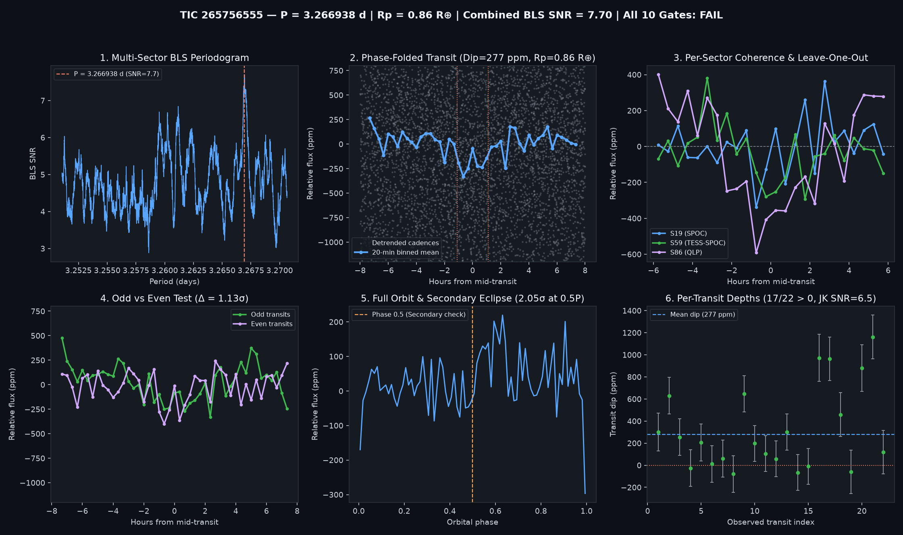

# Candidate Vetting Dossier: TIC 265756555

- **Status**: `watchlist_8_plus_gates` (`all_gates_passed = False`)
- **Generated UTC**: `2026-10-10T18:52:21Z`
- **Host Star**: TIC 265756555 ($T_{\text{mag}} = 10.2306$, $T_{\text{eff}} = 3649\text{ K}$, $R_\star = 0.4720\,R_\odot$, $M_\star = 0.470\,M_\odot$, $d = 28.19\text{ pc}$)
- **Sectors Analyzed**: `[19, 59, 86]`

## Primary Signal Ephemeris & Physical Parameters

| Parameter | Value |
| :--- | :--- |
| **Orbital Period ($P$)** | `3.2669382 d` |
| **Mid-Transit Epoch ($T_0$)** | `1817.42473 BTJD` |
| **Transit Duration ($T_{14}$)** | `2.21 h` (`0.09200 d`) |
| **Weighted Transit Depth ($\Delta F$)** | `277.3 ± 37.0 ppm` (BLS box: `263.9 ppm`) |
| **Combined Multi-Sector BLS SNR** | `7.70 σ` |
| **Inferred Planet Radius ($R_p$)** | **`0.86 R_earth`** (assuming target star host) |

## 10-Gate Adversarial Falsification Scorecard

| Gate | Falsification Test | Key Metric | Result |
| :--- | :--- | :--- | :--- |
| **1** | Catalog & Alert De-duplication | `is_known_in_toi_ctoi_ps = False` | PASS |
| **2** | Multi-Sector / Multi-Epoch Baseline | `3` sectors, `22` transits | PASS |
| **3** | Combined Detrended BLS SNR | `7.7 σ` (min `8.0 σ`) | FAIL |
| **4** | Blind Leave-One-Epoch-Out (LOEO) Prediction | `min Z = 2.15 σ`, `mean Z = 4.16 σ` | PASS |
| **5** | Odd vs. Even Transit Depth Consistency | Odd `233.8 ppm` vs Even `314.2 ppm` (`1.13 σ`) | PASS |
| **6** | Secondary Eclipse Null Test (Phase 0.5) | `82.4 ± 40.3 ppm` (`2.05 σ`) | PASS |
| **7** | Physical Radius & Keplerian Duration | `$R_p = 0.857 R_\oplus$`, `$T_{14}/T_{14,\text{circ}} = 1.349$` | PASS |
| **8** | In/Out-of-Transit Centroid Stability | `Δr = 0.002 arcsec` (`0.9 σ`) | PASS |
| **9** | Per-Transit Coherence & Jackknife Stability | `17/22` positive, Jackknife SNR `6.51 σ` | PASS |
| **10** | Rotational Modulation / Starspot Guard | Detrended OOT sin amp `30.6 ppm` (`11.0%` of dip) | PASS |

## Blind Leave-One-Epoch-Out (LOEO) Cross-Validation Breakdown

| Held-Out Sector | Trained Period (d) | Trained $T_0$ (BTJD) | In-Transit Cadences | Predicted Dip in Held-Out Sector | Z-Score |
| :--- | :--- | :--- | :--- | :--- | :--- |
| Sector 19 | `3.2669164` | `2911.85314` | `528` | `+127.0 ± 59.1 ppm` | **`+2.15 σ`** |
| Sector 59 | `3.2669374` | `1817.42473` | `277` | `+192.4 ± 61.4 ppm` | **`+3.13 σ`** |
| Sector 86 | `3.2669548` | `1817.42473` | `276` | `+543.5 ± 75.6 ppm` | **`+7.19 σ`** |

## Diagnostic Plots

