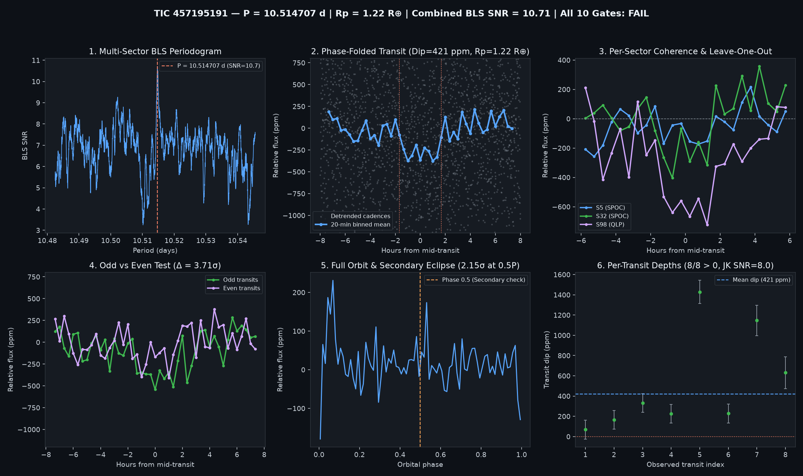

# Candidate Vetting Dossier: TIC 457195191

- **Status**: `watchlist_8_plus_gates` (`all_gates_passed = False`)
- **Generated UTC**: `2026-10-09T17:35:24Z`
- **Host Star**: TIC 457195191 ($T_{\text{mag}} = 9.56008$, $T_{\text{eff}} = 3776\text{ K}$, $R_\star = 0.5465\,R_\odot$, $M_\star = 0.542\,M_\odot$, $d = 26.13\text{ pc}$)
- **Sectors Analyzed**: `[5, 32, 98]`

## Primary Signal Ephemeris & Physical Parameters

| Parameter | Value |
| :--- | :--- |
| **Orbital Period ($P$)** | `10.5147068 d` |
| **Mid-Transit Epoch ($T_0$)** | `1448.00771 BTJD` |
| **Transit Duration ($T_{14}$)** | `3.36 h` (`0.14000 d`) |
| **Weighted Transit Depth ($\Delta F$)** | `421.3 ± 36.5 ppm` (BLS box: `359.7 ppm`) |
| **Combined Multi-Sector BLS SNR** | `10.71 σ` |
| **Inferred Planet Radius ($R_p$)** | **`1.22 R_earth`** (assuming target star host) |

## 10-Gate Adversarial Falsification Scorecard

| Gate | Falsification Test | Key Metric | Result |
| :--- | :--- | :--- | :--- |
| **1** | Catalog & Alert De-duplication | `is_known_in_toi_ctoi_ps = False` | PASS |
| **2** | Multi-Sector / Multi-Epoch Baseline | `3` sectors, `8` transits | PASS |
| **3** | Combined Detrended BLS SNR | `10.71 σ` (min `8.0 σ`) | PASS |
| **4** | Blind Leave-One-Epoch-Out (LOEO) Prediction | `min Z = 2.09 σ`, `mean Z = 6.11 σ` | PASS |
| **5** | Odd vs. Even Transit Depth Consistency | Odd `543.4 ppm` vs Even `283.9 ppm` (`3.71 σ`) | FAIL |
| **6** | Secondary Eclipse Null Test (Phase 0.5) | `71.5 ± 33.3 ppm` (`2.15 σ`) | PASS |
| **7** | Physical Radius & Keplerian Duration | `$R_p = 1.224 R_\oplus$`, `$T_{14}/T_{14,\text{circ}} = 1.26$` | PASS |
| **8** | In/Out-of-Transit Centroid Stability | `Δr = 0.0017 arcsec` (`0.69 σ`) | PASS |
| **9** | Per-Transit Coherence & Jackknife Stability | `8/8` positive, Jackknife SNR `7.96 σ` | PASS |
| **10** | Rotational Modulation / Starspot Guard | Detrended OOT sin amp `13.2 ppm` (`3.1%` of dip) | PASS |

## Blind Leave-One-Epoch-Out (LOEO) Cross-Validation Breakdown

| Held-Out Sector | Trained Period (d) | Trained $T_0$ (BTJD) | In-Transit Cadences | Predicted Dip in Held-Out Sector | Z-Score |
| :--- | :--- | :--- | :--- | :--- | :--- |
| Sector 5 | `10.5146815` | `2184.04090` | `202` | `+135.8 ± 65.1 ppm` | **`+2.09 σ`** |
| Sector 32 | `10.5147376` | `1447.99971` | `202` | `+265.5 ± 64.6 ppm` | **`+4.11 σ`** |
| Sector 98 | `10.5148106` | `1447.99971` | `149` | `+717.4 ± 59.1 ppm` | **`+12.14 σ`** |

## Diagnostic Plots

