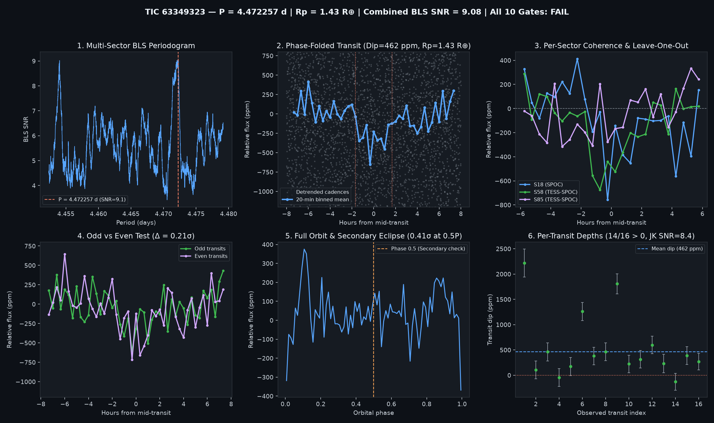

# Candidate Vetting Dossier: TIC 63349323

- **Status**: `watchlist_8_plus_gates` (`all_gates_passed = False`)
- **Generated UTC**: `2026-10-10T19:49:46Z`
- **Host Star**: TIC 63349323 ($T_{\text{mag}} = 10.7167$, $T_{\text{eff}} = 3868\text{ K}$, $R_\star = 0.6115\,R_\odot$, $M_\star = 0.597\,M_\odot$, $d = 53.98\text{ pc}$)
- **Sectors Analyzed**: `[18, 58, 85]`

## Primary Signal Ephemeris & Physical Parameters

| Parameter | Value |
| :--- | :--- |
| **Orbital Period ($P$)** | `4.4722572 d` |
| **Mid-Transit Epoch ($T_0$)** | `1791.36002 BTJD` |
| **Transit Duration ($T_{14}$)** | `3.36 h` (`0.14000 d`) |
| **Weighted Transit Depth ($\Delta F$)** | `461.7 ± 44.6 ppm` (BLS box: `374.7 ppm`) |
| **Combined Multi-Sector BLS SNR** | `9.08 σ` |
| **Inferred Planet Radius ($R_p$)** | **`1.43 R_earth`** (assuming target star host) |

## 10-Gate Adversarial Falsification Scorecard

| Gate | Falsification Test | Key Metric | Result |
| :--- | :--- | :--- | :--- |
| **1** | Catalog & Alert De-duplication | `is_known_in_toi_ctoi_ps = False` | PASS |
| **2** | Multi-Sector / Multi-Epoch Baseline | `3` sectors, `16` transits | PASS |
| **3** | Combined Detrended BLS SNR | `9.08 σ` (min `8.0 σ`) | PASS |
| **4** | Blind Leave-One-Epoch-Out (LOEO) Prediction | `min Z = 1.56 σ`, `mean Z = 4.39 σ` | FAIL |
| **5** | Odd vs. Even Transit Depth Consistency | Odd `453.1 ppm` vs Even `471.1 ppm` (`0.21 σ`) | PASS |
| **6** | Secondary Eclipse Null Test (Phase 0.5) | `19.6 ± 47.4 ppm` (`0.41 σ`) | PASS |
| **7** | Physical Radius & Keplerian Duration | `$R_p = 1.433 R_\oplus$`, `$T_{14}/T_{14,\text{circ}} = 1.546$` | PASS |
| **8** | In/Out-of-Transit Centroid Stability | `Δr = 0.0045 arcsec` (`1.81 σ`) | PASS |
| **9** | Per-Transit Coherence & Jackknife Stability | `14/16` positive, Jackknife SNR `8.44 σ` | PASS |
| **10** | Rotational Modulation / Starspot Guard | Detrended OOT sin amp `44.1 ppm` (`9.5%` of dip) | PASS |

## Blind Leave-One-Epoch-Out (LOEO) Cross-Validation Breakdown

| Held-Out Sector | Trained Period (d) | Trained $T_0$ (BTJD) | In-Transit Cadences | Predicted Dip in Held-Out Sector | Z-Score |
| :--- | :--- | :--- | :--- | :--- | :--- |
| Sector 18 | `4.4717717` | `2887.06481` | `599` | `+364.8 ± 73.2 ppm` | **`+4.99 σ`** |
| Sector 58 | `4.4720604` | `1791.36202` | `360` | `+473.2 ± 71.4 ppm` | **`+6.63 σ`** |
| Sector 85 | `4.4722679` | `1791.36202` | `231` | `+133.9 ± 85.8 ppm` | **`+1.56 σ`** |

## Diagnostic Plots

