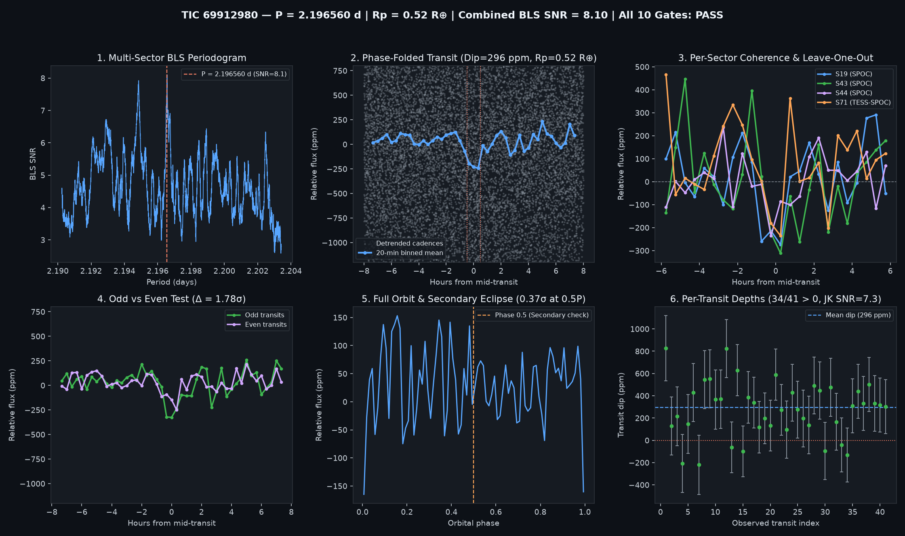

# Candidate Vetting Dossier: TIC 69912980

- **Status**: `candidate_pass_all_10` (`all_gates_passed = True`)
- **Generated UTC**: `2026-10-09T17:35:04Z`
- **Host Star**: TIC 69912980 ($T_{\text{mag}} = 10.1201$, $T_{\text{eff}} = 3401\text{ K}$, $R_\star = 0.2777\,R_\odot$, $M_\star = 0.251\,M_\odot$, $d = 12.44\text{ pc}$)
- **Sectors Analyzed**: `[19, 43, 44, 71]`

## Primary Signal Ephemeris & Physical Parameters

| Parameter | Value |
| :--- | :--- |
| **Orbital Period ($P$)** | `2.1965600 d` |
| **Mid-Transit Epoch ($T_0$)** | `1816.36994 BTJD` |
| **Transit Duration ($T_{14}$)** | `0.96 h` (`0.04000 d`) |
| **Weighted Transit Depth ($\Delta F$)** | `296.1 ± 38.7 ppm` (BLS box: `289.3 ppm`) |
| **Combined Multi-Sector BLS SNR** | `8.10 σ` |
| **Inferred Planet Radius ($R_p$)** | **`0.52 R_earth`** (assuming target star host) |

## 10-Gate Adversarial Falsification Scorecard

| Gate | Falsification Test | Key Metric | Result |
| :--- | :--- | :--- | :--- |
| **1** | Catalog & Alert De-duplication | `is_known_in_toi_ctoi_ps = False` | PASS |
| **2** | Multi-Sector / Multi-Epoch Baseline | `4` sectors, `41` transits | PASS |
| **3** | Combined Detrended BLS SNR | `8.1 σ` (min `8.0 σ`) | PASS |
| **4** | Blind Leave-One-Epoch-Out (LOEO) Prediction | `min Z = 2.87 σ`, `mean Z = 3.71 σ` | PASS |
| **5** | Odd vs. Even Transit Depth Consistency | Odd `366.7 ppm` vs Even `234.7 ppm` (`1.78 σ`) | PASS |
| **6** | Secondary Eclipse Null Test (Phase 0.5) | `14.0 ± 37.8 ppm` (`0.37 σ`) | PASS |
| **7** | Physical Radius & Keplerian Duration | `$R_p = 0.521 R_\oplus$`, `$T_{14}/T_{14,\text{circ}} = 0.924$` | PASS |
| **8** | In/Out-of-Transit Centroid Stability | `Δr = 0.0024 arcsec` (`1.04 σ`) | PASS |
| **9** | Per-Transit Coherence & Jackknife Stability | `34/41` positive, Jackknife SNR `7.27 σ` | PASS |
| **10** | Rotational Modulation / Starspot Guard | Detrended OOT sin amp `14.8 ppm` (`5.0%` of dip) | PASS |

## Blind Leave-One-Epoch-Out (LOEO) Cross-Validation Breakdown

| Held-Out Sector | Trained Period (d) | Trained $T_0$ (BTJD) | In-Transit Cadences | Predicted Dip in Held-Out Sector | Z-Score |
| :--- | :--- | :--- | :--- | :--- | :--- |
| Sector 19 | `2.1965594` | `2475.33764` | `336` | `+332.2 ± 76.5 ppm` | **`+4.34 σ`** |
| Sector 43 | `2.1965594` | `1816.36994` | `287` | `+238.0 ± 72.6 ppm` | **`+3.28 σ`** |
| Sector 44 | `2.1965536` | `1816.36994` | `287` | `+233.5 ± 81.4 ppm` | **`+2.87 σ`** |
| Sector 71 | `2.1965594` | `1816.36994` | `154` | `+347.5 ± 79.9 ppm` | **`+4.35 σ`** |

## Diagnostic Plots

