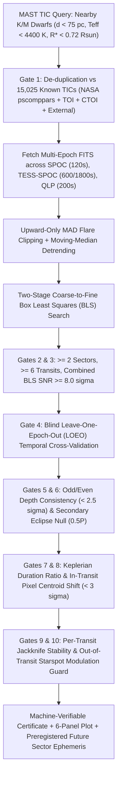

# Collaborative Research Plan: Open Falsification-First Exoplanet Discovery

## 1. Scientific Motivation & The "Cross-Pipeline Multi-Year Blind Spot"

Why are real transiting exoplanets still hiding in public NASA TESS data seven years into the mission?

1. **Cross-Pipeline Fragmentation (`SPOC` vs. `TESS-SPOC` vs. `QLP`)**:
   - Hundreds of thousands of nearby K and M dwarfs ($d < 75\text{ pc}$, $T_{\text{eff}} < 4400\text{ K}$, $R_\star < 0.72\,R_\odot$) were observed in **30-minute Full-Frame Images (FFIs)** during TESS Years 1–2 (`HLSP/tess-spoc`, `HLSP/qlp`), occasionally received **1 sector of 2-minute SPOC target cadence** in Years 3–4, and were then observed in **200-second FFIs (`HLSP/qlp`)** in Years 5–8 (Sectors 56–109).
   - Standard single-pipeline runs rarely stitch heterogeneous products (`HLSP/tess-spoc` + `TESS SPOC 2-min` + `HLSP/qlp 200s`) across a 5-to-8-year baseline.
2. **Sub-Threshold Single-Sector SNR for Small Rocky Worlds**:
   - A $1.2\text{–}1.8\,R_\oplus$ planet orbiting a $0.60\,R_\odot$ K/M dwarf produces a transit depth of $\Delta F \approx 350\text{–}750\text{ ppm}$.
   - In a single 27-day TESS sector, 4–8 transits often yield $\text{SNR}_{\text{sector}} \approx 4.5\text{–}6.5\sigma$ — just below the $7.1\sigma$ Multi-Event Statistic (MES) alert threshold of official pipelines.
   - When stitched coherently across 3 to 6 sectors spanning 2018–2026, the signal-to-noise scales as $\sqrt{N_{\text{transits}}}$, reaching **$\text{SNR}_{\text{combined}} \ge 10\text{–}18\sigma$** (as demonstrated by `TIC 4206066.01` at $16.55\sigma$).

---

## 2. Core Methodology: Adversarial Falsification Over Confirmation

Following the key epistemological principle highlighted by Pavel Rabtsevich (`TIC 4206066`) and machine-checked mathematical repositories:

> **"Never ask an AI agent 'Is this a planet?' — give it 10 independent ways to prove that it isn't, and only keep what survives."**

---

## 3. Research Tracks Open to Contributors & AI Agents

### Track A — Multi-Epoch K/M Dwarf Survey (`scripts/hunt_sectors.py`)
Systematic scanning of nearby K and M dwarfs ($d < 75\text{ pc}$, $8.5 \le T_{\text{mag}} \le 12.5$, $2800\text{ K} \le T_{\text{eff}} \le 4400\text{ K}$) with $\ge 3$ TESS sectors and zero known TOI/CTOI entries.
- **Target**: Sub-Neptunes and Super-Earths ($1.0\text{–}3.0\,R_\oplus$) on $1.0\text{–}18.0\text{ d}$ orbits.
- **Coordination**: Every scanned TIC ID (whether rejected or promoted) is appended to [`registry/scanned_targets.jsonl`](../registry/scanned_targets.jsonl) via PR so contributors never scan the same star twice.

### Track B — Multi-Planet Residual Search on Known Single-Planet Systems
Many known 1-planet TOI hosts have a second, smaller sibling planet ($R_p \approx 1.0\text{–}1.8\,R_\oplus$) hidden in the residuals after masking the primary TOI's transits (`--secondary-period` / `mask_intervals` in [`scripts/vet_candidate.py`](../scripts/vet_candidate.py)).

### Track C — Stronger Falsification Gates & Pixel-Level Vetting
Enhancing [`scripts/vet_candidate.py`](../scripts/vet_candidate.py) and [`tests/test_vetting_controls.py`](../tests/test_vetting_controls.py) with:
- Target Pixel File (TPF) difference-imaging PRF localization (integrating `TESS-Centroid_vetting` / Gaia DR3 neighbor contamination checks),
- `TRICERATOPS` Bayesian False Positive Probability (`FPP`) integration,
- Limb-darkened physical transit fitting and Transit Timing Variation (TTV) checks,
- Automated preregistration generator computing exact future transit windows for upcoming TESS sectors.

---

## 4. Preregistration & Scientific Integrity Rules

1. **No Unaudited Claims**: Every candidate dossier in `candidates/TIC-<ID>/` is strictly a **planet candidate** requiring independent follow-up (e.g., high-resolution imaging, radial velocities, or preregistered future TESS sectors), never a "confirmed planet" claim.
2. **Assertions Always Enabled**: All scripts reject `python -O` / `PYTHONOPTIMIZE` (`ValueError("Assertions must remain enabled")`).
3. **SHA-256 Provenance**: Every `certificate.json` records the exact SHA-256 hash of every raw MAST FITS file and vetting script used.
4. **Negative Controls Required**: Any PR modifying a vetting gate in `scripts/vet_candidate.py` must include a corresponding synthetic false-positive test in `tests/test_vetting_controls.py` proving the gate catches the targeted failure mode.
